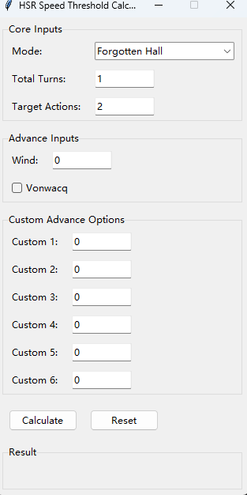

# HSR Speed Threshold Calculator

A small Tkinter GUI for **Honkai: Star Rail** that computes the **minimum Speed** a character needs to take a given number of actions within a given number of turns, accounting for the game mode's action-value budget and any action-advance effects (Wind set, Vonwacq, and custom sources).

All inputs are visible in one window; the result is a single number.



## How the calculation works

Honkai: Star Rail schedules actions by **action value (AV)**. A character with Speed *s* needs 10,000 / *s* AV per action, and each game mode gives a fixed amount of AV per turn:

| Mode | First turn | Each additional turn |
| --- | ---: | ---: |
| Forgotten Hall / Memory of Chaos | 150 AV | +100 AV |
| Anomaly Arbitration | 300 AV | +100 AV |

Action-advance effects are converted to AV and subtracted from what the character has to cover by Speed alone:

| Source | Advance | Modeled as |
| --- | ---: | --- |
| Wind set (Eagle of Twilight Line, 4-piece) | 25% per trigger | `Wind` × 0.25 × 10,000 |
| Sprightly Vonwacq | 40% once | 0.40 × 10,000 if ticked |
| Custom 1–6 | as entered | value × 10,000 each |

The tool then solves for the smallest integer Speed such that

```
Speed × total_AV  ≥  10,000 × target_actions − total_advance_AV
```

i.e. `Speed = ceil((10,000 × target_actions − total_advance_AV) / total_AV)`.

### Worked examples (no advance effects)

| Goal | total_AV | Calculation | Result |
| --- | ---: | --- | ---: |
| 2 actions in 1 turn, Forgotten Hall | 150 | 20,000 / 150 = 133.3 | **134** |
| 3 actions in 2 turns, Forgotten Hall | 250 | 30,000 / 250 = 120 | **120** |
| 4 actions in 2 turns, Forgotten Hall | 250 | 40,000 / 250 = 160 | **160** |
| 3 actions in 1 turn, Anomaly Arbitration | 300 | 30,000 / 300 = 100 | **100** |

These reproduce the commonly cited breakpoints (134, 120, 160), which is a quick way to check the tool is behaving as expected.

## Installation and usage

**Requirements:** Python 3.9+ with Tkinter (bundled with standard Python installers on Windows and macOS; on some Linux distributions install `python3-tk`). No third-party packages.

```bash
python hsr_speed_calculator.py
```

## Input guide

| Field | Meaning |
| --- | --- |
| **Mode** | Forgotten Hall (150 AV first turn) or Anomaly Arbitration (300 AV first turn). Both add 100 AV per additional turn. |
| **Total Turns** | Number of turns the actions must fit in. The first turn counts as 1. For "4 actions in 2 turns", enter 2. |
| **Target Actions** | Number of actions the character should take within those turns. |
| **Wind** | Number of times the Wind set's 25% advance triggers (once per Ultimate used). Integer, default 0. |
| **Vonwacq** | Tick if the character wears Sprightly Vonwacq; applies a single 40% advance at battle start. |
| **Custom 1–6** | Additional advance sources (e.g. Dance Dance Dance, Bronya, Sparkle), entered as fractions. `24` and `0.24` are both read as 24%; `0` or blank means none. Any value with absolute value ≥ 1 is divided by 100, so enter 100% as `0.99` or split it across two fields rather than typing `1` (which is read as 1%). |

**Vonwacq caveat:** in-game, Sprightly Vonwacq only triggers if the wearer's Speed is at least 120. If the calculator returns a value below 120 with Vonwacq ticked (for example 107 for 2 actions in 1 Forgotten Hall turn), that Speed will not actually work; untick Vonwacq and use the higher result.

## Output

A single line: **Required Speed to achieve the desired actions: N**. The number already includes the mode's AV budget, the turn count, every advance source, and ceiling to the next integer.

## Project structure

```text
hsr-speed-calculator/
├── hsr_speed_calculator.py
├── README.md
├── docs/
│   └── screenshot.png
└── .gitattributes
```

## Limitations

- Does not check in-game feasibility (relic substat limits, speed caps on specific characters).
- Assumes advances happen before the actions they are meant to enable; it does not simulate the turn order.
- Only the two listed modes are built in; other modes can be approximated by choosing the one with the matching first-turn AV.

## Disclaimer

Provided for personal and educational use as a planning and theorycrafting aid. Not affiliated with or endorsed by HoYoverse.
